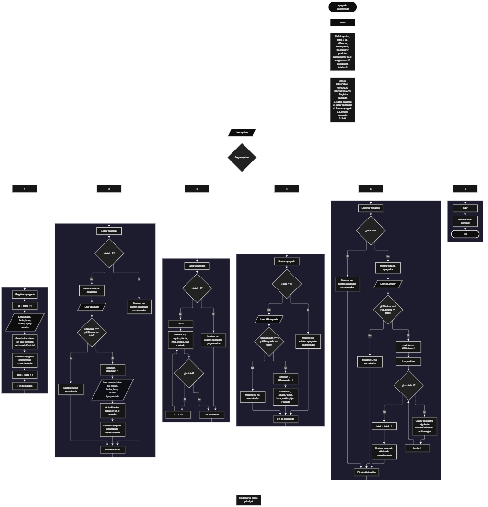

Este proyecto, llamado <b>apagado programado</b>, fue desarrollado en <b>Java</b> como un ejercicio práctico para fortalecer la lógica de programación mediante la creación de un sistema de gestión de apagados programados desde la consola. El programa cuenta con un menú principal de seis opciones que permite <b>registrar, editar, listar, buscar y eliminar</b> los apagados programados, además de finalizar la ejecución del sistema. Cada registro almacena información como el nombre del equipo, la fecha y hora del apagado, el motivo, el tipo de apagado y el estado de la programación, utilizando arreglos con una capacidad de <b>10 registros durante la ejecución</b>. Durante su desarrollo se aplicaron conceptos fundamentales de programación, como variables, arreglos, estructuras condicionales, ciclos repetitivos y estructuras de selección, además de procesos para buscar, modificar, eliminar y organizar registros. Este proyecto permite poner en práctica los conocimientos adquiridos en Java y sirve como base para desarrollar sistemas de gestión más avanzados utilizando otros lenguajes y tecnologías.

<h2 align="center">⚙️ Funcionamiento del menú principal</h2>

### ➕ Registrar apagado

La opción <b>1) registrar apagado</b> permite almacenar un nuevo apagado programado en el sistema. Para comenzar, el programa calcula el identificador mediante la expresión <b>total + 1</b> y muestra el ID correspondiente al registro que se va a realizar. Después, solicita el <b>nombre del equipo, fecha del apagado, hora del apagado, motivo del apagado, tipo de apagado y estado de la programación</b>. Los datos introducidos se almacenan en la posición actual de sus respectivos arreglos: <b>equipos, fechas, horas, motivos, tipos y estados</b>. Finalmente, muestra el mensaje <b>"Apagado programado correctamente."</b> y aumenta la variable <b>total</b> en uno para actualizar la cantidad de registros almacenados.

### ✏️ Editar apagado

La opción <b>2) editar apagado</b> permite modificar la información de un apagado programado existente. Primero, el programa comprueba si existen registros almacenados mediante la condición <b>total == 0</b>. Si no hay apagados registrados, muestra el mensaje <b>"No existen apagados programados."</b>. En caso contrario, presenta una lista con los identificadores, nombres de los equipos, fechas, horas, motivos, tipos y estados de los apagados. Después, solicita el ID del apagado que se desea editar y comprueba que esté dentro del rango permitido mediante la condición <b>idBuscar &gt;= 1 && idBuscar &lt;= total</b>. Si la selección es válida, obtiene la posición correspondiente restando uno al ID mediante <b>posicion = idBuscar - 1</b>. A continuación, solicita nuevamente los seis datos y actualiza directamente los valores de los arreglos correspondientes. Finalmente, presenta el mensaje <b>"Apagado actualizado correctamente."</b>. Si el ID ingresado no corresponde a un registro existente, muestra el mensaje <b>"ID no encontrada."</b>.

### 📋 Listar apagados

La opción <b>3) listar apagados</b> permite visualizar todos los apagados programados que se encuentran registrados en el sistema. Antes de mostrar la información, el programa comprueba si la variable <b>total</b> es igual a cero. Si no existen registros, presenta el mensaje <b>"No existen apagados programados."</b>. Si hay apagados disponibles, muestra el título <b>"Lista de apagados"</b> y utiliza un ciclo <b>for</b> para recorrer los arreglos desde la primera posición hasta el total de registros almacenados. Durante el recorrido, muestra el ID, nombre del equipo, fecha, hora, motivo, tipo y estado de cada programación. Esta función facilita consultar todos los apagados registrados sin necesidad de buscarlos individualmente.

### 🔎 Buscar apagado

La opción <b>4) buscar apagado</b> permite localizar un apagado programado mediante su identificador. Primero, el programa comprueba si existen registros almacenados. Si no hay apagados registrados, muestra el mensaje <b>"No existen apagados programados."</b>. En caso contrario, presenta el título <b>"busqueda de apagado"</b> y solicita el ID que se desea buscar. Después, verifica que el identificador introducido esté dentro del rango permitido mediante la condición <b>idBusqueda &gt;= 1 && idBusqueda &lt;= total</b>. Si el ID es válido, calcula la posición correspondiente utilizando <b>posicion = idBusqueda - 1</b> y muestra todos los datos del apagado encontrado: <b>equipo, fecha, hora, motivo, tipo y estado</b>. Si el identificador no corresponde a un registro existente, presenta el mensaje <b>"ID no encontrada."</b>. La búsqueda se realiza mediante el ID y no mediante el nombre del equipo.

### 🗑️ Eliminar apagado

La opción <b>5) eliminar apagado</b> permite eliminar un registro mediante su identificador. Antes de comenzar, el programa comprueba si existen apagados almacenados. Si el sistema está vacío, muestra el mensaje <b>"No existen apagados programados."</b>. Si hay registros disponibles, presenta una lista con los datos de todos los apagados para facilitar su identificación. Después, solicita el ID del apagado que se desea eliminar y verifica que esté dentro del rango válido. Si el registro existe, obtiene su posición mediante <b>posicion = idEliminar - 1</b> y comienza el proceso de eliminación. Para mantener los registros organizados, utiliza un ciclo <b>for</b> que desplaza una posición hacia la izquierda los datos posteriores en los seis arreglos: <b>equipos, fechas, horas, motivos, tipos y estados</b>. Posteriormente, disminuye la variable <b>total</b> en uno y muestra el mensaje <b>"Apagado eliminado correctamente."</b>. Si el ID seleccionado no corresponde a un registro existente, presenta el mensaje <b>"ID no encontrada."</b>.

### 🚪 Salir del menú principal

La opción <b>6) salir</b> está destinada a finalizar la ejecución del programa y muestra el mensaje <b>"Gracias por utilizar Apagado Programado."</b>. El menú principal se encuentra dentro de una estructura repetitiva <b>do-while</b>, que mantiene el programa en funcionamiento mientras el usuario realiza las operaciones disponibles. La condición <b>opcion != 6</b> permite repetir el menú hasta que se seleccione la opción 6. Cuando esto ocurre, el ciclo finaliza y el programa cierra el objeto <b>Scanner</b> mediante la instrucción <b>entrada.close()</b>.

<h2 align="center">🧠 Temas aplicados en el proyecto</h2>

### 📦 Variables

En este proyecto se utilizan variables para almacenar la opción seleccionada en el menú, controlar la cantidad de apagados registrados, recorrer los arreglos, identificar los registros que se desean editar, buscar o eliminar y determinar la posición correspondiente de cada apagado. Cada variable cumple una función específica dentro de las operaciones de gestión de los registros.

🔢 **Opcion:** Almacena la opción seleccionada por el usuario en el menú principal.

📊 **Total:** Almacena la cantidad actual de apagados programados.

🔄 **I:** Funciona como contador en los ciclos <b>for</b> y permite recorrer los arreglos y desplazar los registros durante la eliminación.

🆔 **Id:** Almacena temporalmente el identificador generado para el nuevo apagado.

🔎 **IdBuscar:** Almacena el identificador introducido para seleccionar el apagado que se desea editar.

🔍 **IdBusqueda:** Almacena el identificador introducido para buscar un apagado.

🗑️ **IdEliminar:** Almacena el identificador del apagado que se desea eliminar.

📍 **Posicion:** Almacena la posición del arreglo correspondiente al identificador seleccionado.

### 🗃️ Arreglos

En este proyecto se utilizan seis arreglos relacionados con la información de cada apagado programado. Cada arreglo tiene una capacidad de <b>10 posiciones</b> y utiliza el mismo índice para representar los datos correspondientes a un mismo registro. Por ejemplo, la información de un apagado almacenado en la posición <b>0</b> se encuentra distribuida entre <b>equipos[0], fechas[0], horas[0], motivos[0], tipos[0] y estados[0]</b>. Esta organización permite recorrer, buscar, modificar, mostrar y eliminar los registros de manera ordenada.

💻 **Equipos[10]:** Almacena los nombres de los equipos registrados.

📅 **Fechas[10]:** Almacena las fechas programadas para los apagados.

🕒 **Horas[10]:** Almacena las horas programadas para los apagados.

📝 **Motivos[10]:** Almacena los motivos de cada apagado programado.

⚙️ **Tipos[10]:** Almacena los tipos de apagado registrados.

📊 **Estados[10]:** Almacena los estados de las programaciones.

### 🔀 Estructuras condicionales

En este proyecto se utilizan las estructuras <b>if-else</b> para comprobar si existen apagados registrados antes de realizar determinadas operaciones y verificar que el identificador introducido corresponda a un registro existente. Estas condiciones permiten controlar las operaciones de edición, búsqueda y eliminación, así como mostrar mensajes cuando no existen registros o cuando el ID seleccionado no es válido.

### 🔄 Estructuras repetitivas

En este proyecto se utilizan los ciclos <b>for</b> y <b>do-while</b>. Los ciclos <b>for</b> permiten recorrer los arreglos para mostrar los apagados registrados y reorganizar los datos durante la eliminación de un registro. Por otro lado, el ciclo <b>do-while</b> mantiene activo el menú principal para que el usuario pueda realizar diferentes operaciones y continuar utilizando el programa hasta seleccionar la opción de salida.

### 🎯 Estructura switch

El programa utiliza la estructura <b>switch</b> para evaluar el valor almacenado en la variable <b>opcion</b> y ejecutar el bloque de instrucciones correspondiente. Cada caso representa una operación específica del sistema: <b>registrar, editar, listar, buscar, eliminar o salir</b>. También se utiliza el bloque <b>default</b> para mostrar el mensaje <b>"Opcion no valida."</b> cuando el usuario introduce un número que no corresponde a ninguna de las opciones definidas en el menú.

### 🔢 Inicialización y capacidad de los arreglos

El programa utiliza la instrucción <b>new String[10]</b> para crear seis arreglos de tipo texto, cada uno con una capacidad de <b>10 posiciones</b>. Estos arreglos permiten almacenar la información correspondiente a los apagados programados. La cantidad de posiciones ocupadas se controla mediante la variable <b>total</b>, que aumenta al registrar un nuevo apagado y disminuye cuando se elimina un registro. Aunque los arreglos tienen una capacidad de 10 registros, el código actual no incluye una comprobación que impida registrar información cuando se alcanza ese límite.

### 🔄 Reorganización de registros

Cuando se selecciona un apagado para eliminarlo, el programa utiliza un ciclo <b>for</b> que comienza en la posición seleccionada y continúa mientras <b>i &lt; total - 1</b>. En cada repetición, los datos de la posición siguiente se copian sobre la posición actual en los seis arreglos: <b>equipos, fechas, horas, motivos, tipos y estados</b>. Después, la variable <b>total</b> disminuye en uno. De esta manera, los registros posteriores ocupan las posiciones disponibles y se mantiene organizada la información almacenada, sin espacios vacíos entre los registros activos.

<h2 align="center">¿Cómo se implementaron las operaciones CRUD en el proyecto?</h2>

Las operaciones <b>CRUD</b> se implementaron mediante las opciones del menú principal, permitiendo administrar los apagados programados. La operación <b>crear</b> corresponde a <b>registrar apagado</b>, donde se introducen los datos de un nuevo registro; <b>leer</b> se realiza mediante las opciones <b>buscar apagado y listar apagados</b>, que permiten consultar la información almacenada; <b>actualizar</b> corresponde a <b>editar apagado</b>, donde se modifican los datos de un registro existente; y <b>eliminar</b> se realiza mediante la opción <b>eliminar apagado</b>, que retira un registro y reorganiza los arreglos. Estas operaciones utilizan variables, arreglos, condicionales y ciclos para gestionar la información almacenada temporalmente durante la ejecución del programa.

<h2 align="center">Diagrama de flujo del proyecto</h2>

<h2 align="center">🛡️ Validaciones del programa</h2>

### 📭 No existen apagados programados

Esta comprobación se utiliza en las opciones de <b>editar, listar, buscar y eliminar apagado</b>. El programa verifica si la variable <b>total</b> es igual a <b>0</b> y, si no existen registros almacenados, muestra el mensaje <b>"No existen apagados programados."</b>. Esta comprobación evita continuar con las operaciones que necesitan información almacenada cuando el sistema está vacío.

### 🔢 Selección de apagados

El programa utiliza los identificadores para seleccionar los apagados que se desean editar, buscar o eliminar. Antes de realizar estas operaciones, comprueba que el ID introducido sea mayor o igual a <b>1</b> y menor o igual al valor de <b>total</b>. Si la selección está dentro de ese rango, calcula la posición correspondiente restando uno al identificador. De esta manera, el programa puede acceder al registro correcto dentro de los arreglos.

### ❌ ID no encontrada

Esta validación se utiliza cuando el identificador introducido no corresponde a ningún apagado registrado. El programa comprueba si el ID se encuentra dentro del rango permitido y, si no cumple esta condición, muestra el mensaje <b>"ID no encontrada."</b>. Esta comprobación se aplica durante las operaciones de <b>editar, buscar y eliminar apagado</b>, evitando acceder a posiciones que no corresponden a registros existentes.

### ⚠️ Capacidad de almacenamiento

Los seis arreglos utilizados en el programa tienen una capacidad de <b>10 registros</b>. Sin embargo, el código actual no incluye una validación que compruebe si todavía existe espacio disponible antes de registrar un nuevo apagado. Por este motivo, si se intenta almacenar un registro cuando los 10 espacios están ocupados, el programa puede generar un error al intentar acceder a una posición fuera de los límites del arreglo.

### ⚠️ Opción inválida

La estructura <b>switch</b> incluye el bloque <b>default</b>, que muestra el mensaje <b>"Opcion no valida."</b> cuando el usuario introduce un número que no corresponde a ninguna de las seis opciones definidas en el menú principal. Esta condición permite informar al usuario cuando selecciona una opción que no está disponible.

<h2 align="center">🎯 Objetivo del proyecto</h2>

El objetivo principal de este proyecto es fortalecer la <b>lógica de programación</b> mediante el desarrollo de un sistema de gestión de apagados programados en <b>Java</b>. A través de su construcción se busca aplicar los conocimientos adquiridos sobre variables, arreglos, estructuras condicionales, ciclos repetitivos y estructuras de selección, integrándolos para resolver un problema de manera organizada. Además, el proyecto permite comprender cómo registrar, consultar, modificar y eliminar información en una aplicación de consola, estableciendo una base para desarrollar sistemas de gestión más completos con otros lenguajes y tecnologías.

